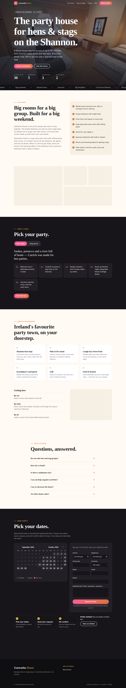

# gasworkshousecarrick.com

A custom one-page WordPress theme for **Gasworks House**, a boutique hen and stag house in Carrick-on-Shannon.



## What's on the page

- **Hero**: headline, key facts (guests, bedrooms, bathrooms, minimum nights) and a booking button
- **The house**: description and a feature checklist
- **Photo tour**: a room-by-room tour of the house (room list, large photo viewer with the room's beds and description, a strip of every photo, and full screen with swipe and arrow keys). Your photos are built in.
- **Hens & stags**: a hen/stag toggle with party ideas for each
- **Carrick-on-Shannon**: things to do, directions and a Google Map
- **Reviews**: hidden until you add real guest reviews
- **FAQ**
- **Direct booking**: a live availability calendar synced with Airbnb, price breakdown and request-to-book (see below)
- A sticky "Book" button on mobile, SEO meta tags and Google structured data (LodgingBusiness)

## Pages and menus

Besides the homepage (which shows everything), the theme creates these pages the first time you open the WordPress dashboard after uploading it. They're listed under **Pages**, and the text you type in each page's editor appears as its intro:

| Page | Address | Shows |
|---|---|---|
| The House | /the-house/ | Description, features, photo tour |
| Hens & Stags | /hens-and-stags/ | Hen and stag ideas |
| Carrick-on-Shannon | /carrick-on-shannon/ | Things to do, getting here, map |
| FAQ | /faq/ | Questions and answers (and reviews, once added) |
| Book | /book/ | Calendar and booking (linked from the "Check dates" button) |
| Contact | /contact/ | WhatsApp, call, email, address, map |
| Terms & Conditions, Cancellation Policy, Privacy Policy | | **Drafts** for you to review: fill in the [bracketed] parts and publish. They appear in the footer once published, and the booking form then asks guests to agree to the terms. |

The header menu (**Appearance → Menus → Main menu**) and footer links are set up for you. An existing empty menu from your old theme is filled in rather than replaced, and a menu that already has links is left alone. The header always uses the light logo, because a logo with dark lettering set under **Site Identity** would disappear on the dark header.

## Install on Hostinger WordPress

1. Download `gasworks-house.zip` from this folder. If you change the theme, rebuild it with `./build.sh`.
2. In WordPress admin go to **Appearance → Themes → Add New Theme → Upload Theme**, choose the zip, then click **Install Now** and **Activate**.
3. Go to **Appearance → Customize → Gasworks House** and fill in each section:
   - **Booking & contact**: already set to stay@gasworkshousecarrick.com and 086 174 2808 (calls and WhatsApp). Change them here if needed. Also: your Airbnb listing URL (shown as a secondary "Prefer Airbnb?" option), email, phone and WhatsApp
   - **The house**: guest numbers, bedrooms, bathrooms, description and features
   - **Photo tour**: optional. Pick up to 20 photos to replace the built-in ones, and label each as `Room | description` (e.g. `The Attic Room | Three singles under the eaves`). Photos with the same room name are grouped together.
   - **Hero & SEO**: the main photo at the top of the page (built in: the kitchen with the stove lit) and your Google description
   - **Things to do & location**: already set to **Gasworks House, Station Road, Carrick-on-Shannon, Co. Roscommon, N41 DW99**. "Open in Google Maps" links go to your Business Profile listing, and "Get directions" routes to the house
   - **Reviews & FAQ**
4. Your logo and favicon are built in (see Branding below). Set the site title to "Gasworks House Carrick" under **Customize → Site Identity**.
5. If Hostinger's **LiteSpeed Cache** is on, purge the cache after each change (**LiteSpeed Cache → Toolbox → Purge All**).
6. Set up bookings (next section), then send yourself a test request. If the email doesn't arrive, the request is still saved under **Bookings**. For reliable email, set up Hostinger email and an SMTP plugin such as WP Mail SMTP.
7. Under **Settings → General**, set the timezone to **Dublin** so "today" is correct on the calendar.

## Direct booking & Airbnb sync

Everything is under **Bookings → Settings & Airbnb sync** in WordPress.

**Connect Airbnb (two-way calendar sync):**

1. **Airbnb → website:** in Airbnb, open your listing's **Calendar → Availability → Sync calendars → Export calendar**. Copy the link (it looks like `https://www.airbnb.ie/calendar/ical/50016674.ics?s=…`) and paste it into the settings page. Airbnb bookings then block those dates on your website. The site checks every hour, and again just before accepting a request.
2. **Website → Airbnb:** copy the **export link** shown on the settings page. In Airbnb go to **Sync calendars → Import calendar**, paste it and name it "Website". Airbnb then blocks dates booked on your site. Only the dates are shared, never guest details.

Airbnb only re-reads imported calendars every few hours, so there's a small window where someone could book the same dates on Airbnb. Requests are held rather than auto-confirmed, so you'll always spot a clash before confirming, and the Confirm button refuses if the dates now clash.

**How a booking works:**

1. The guest picks dates on the calendar (booked nights are greyed out, and the minimum stay is enforced) and sees the price.
2. They send a request. The dates are **held** (default 3 days) and blocked on your site and on Airbnb, and both of you get an email.
3. In **Bookings**, click **Confirm & email guest**. The guest gets your payment instructions (bank details or a payment link). Or click **Decline**, and they get a polite email.
4. Requests you don't act on expire after the hold period, and the dates free up again.

You can also add phone or email bookings, or block dates for maintenance, with **Bookings → Add booking or block dates**. Without online payments set up, guests pay using your payment instructions. With myPOS (or Stripe) set up, see Online payments below.

**Prices** (already set as the defaults; change them in the settings page):

| | Midweek (Sun–Thu nights) | Weekend (Fri & Sat nights) |
|---|---|---|
| Whole house, up to 12 guests | €500 per night | €700 per night |
| Each guest over 12 | €60 per person per night | €70 per person per night |

Plus a €60 cleaning fee per stay. Example: 20 guests, Friday to Sunday = €1,400 + (8 × €70 × 2) + €60 = **€2,580**.

The €300 damage deposit is a **card pre-authorisation** (a hold, not a charge). It's shown to guests and in emails but isn't added to the total. With online payments set up, the site places and releases the hold automatically (see Online payments). Without them, place it yourself close to check-in, because card holds lapse after about 7 days.

Prices can't be pulled from Airbnb automatically (Airbnb's calendar link only contains dates), so keep your Airbnb prices in step by hand.

## Online payments (myPOS)

Guests book instantly and pay by card, Apple Pay or Google Pay on **myPOS's secure payment page**. Until a payment provider is set up, the site takes requests instead (see above). Stripe is still built in as an alternative (see the end of this section).

**What happens:**

1. The guest picks dates, enters their group size, optionally adds the Moon River cruise, and clicks **Book & pay**. The dates are held for about 30 minutes while they're on the myPOS page.
2. They pay a **30% deposit**, or the full amount if arriving within 14 days. myPOS stores a secure token for the card (the card number never touches your site). myPOS tells the website the payment went through, and the booking is confirmed and emailed straight away.
3. **14 days before arrival**, the balance is taken.
4. **The day before arrival**, a **€300 damage-deposit hold** is placed (a hold, not a charge). It's released automatically **2 days after check-out**, unless you capture some or all of it from the booking screen.
5. If anything needs the guest (card declined, or the bank wants approval), the guest is emailed a secure link and you're emailed too. The booking screen shows what's outstanding.

**Steps 3 and 4 have two modes:**

- **Fully automatic.** The balance and the hold go on the saved card with nothing for the guest to do. myPOS has to switch on stored-card payments for your store first. Ask myPOS support to enable *card tokenisation / recurring payments (IPCIAPurchase and IPCIAPreAuthorization with a card token)*. Then tick **Automatic card charges** in the settings.
- **Link mode** (the default until then). On the day each one is due, the guest is emailed a secure myPOS link to pay the balance or approve the hold. It still runs by itself; the guest just taps the link.

Safety built in:
- Every message to and from myPOS is signed and checked.
- A payment for the wrong amount is refused.
- If someone books the same dates on Airbnb while a guest is paying, the website refuses the payment, myPOS reverses it, and the guest is told they weren't charged.

Refunds are done in your myPOS account.

**Setup (about 15 minutes):**

1. In your myPOS account, go to **Online → Online stores** and create a store for `gasworkshousecarrick.com`. If you can, start with a test store.
2. Open the store's integration or keys page and generate the **Configuration pack**: one long block of text that holds your store ID, wallet and keys.
3. In WordPress, go to **Bookings → Settings & Airbnb sync → 4. Online payments**. Choose **myPOS**, paste the pack, tick **Test mode**, and save. **Never send the pack by email or chat.** It contains your private key. To keep it out of the database, add `define( 'GWH_MYPOS_CONFIG_PACK', '…' );` to `wp-config.php` instead (Hostinger → File Manager).
4. If myPOS asks for a notification URL, use the one shown on the settings page (`https://gasworkshousecarrick.com/?gwh_mypos=notify`). It must be https.
5. Make a test booking using myPOS's test cards from their developer site. Check the confirmation email and the booking screen.
6. Go live: generate the pack for your live store, paste it in, untick **Test mode**, and make a small real booking to confirm.

**Moon River cruise add-on:** €25 per person, and guests choose the headcount (up to their group size) and which day of their stay. It's added to the total and marked "subject to availability"; you book the sailing with Moon River. Change the name, price and text, or switch it off, under **5. Cruise add-on** in the settings.

**Stripe instead:** choose **Stripe** under *Take payments with* and follow the steps on the settings page: a secret key plus a webhook for `checkout.session.completed`, `checkout.session.async_payment_succeeded` and `checkout.session.expired`. Each booking remembers which provider took its deposit, so switching later doesn't break existing bookings.

## Automation

These run by themselves every hour:

| Job | When |
|---|---|
| Airbnb calendar sync (both ways) | hourly, plus right before every booking |
| Unpaid checkouts and expired requests free their dates | hourly |
| Balance charged, or payment link emailed | 14 days before arrival |
| Damage hold placed, or approval link emailed | 1 day before arrival |
| Damage hold released | 2 days after check-out |
| **Arrival details** to the guest, with a copy to you (includes any unpaid balance and the cruise booking) | 3 days before arrival |
| **Thank-you + review request** (links to your Google profile) | day after check-out |

Edit the arrival text (fill in parking, how to get in, Wi-Fi) and the review link, or switch the emails off, under **6. Automatic guest emails**. That section also shows when the jobs last ran.

**Set up the Hostinger cron job (important).** WordPress only runs scheduled jobs when someone visits the site. To make payments and emails go out on time:

1. In hPanel go to **Advanced → Cron Jobs**, choose *Custom*, and run every 15 minutes. Use this command:
   `wget -q -O - "https://gasworkshousecarrick.com/wp-cron.php?doing_wp_cron" >/dev/null 2>&1`
2. Optionally add `define( 'DISABLE_WP_CRON', true );` to `wp-config.php` so visitors never wait on it.

## Speed & search

Built in:
- Hero photo served as WebP, with a 32 KB version for phones and 94 KB for desktop (was 253 KB). It's preloaded so it appears first.
- All scripts are deferred.
- WordPress extras the site doesn't use (emoji script, block styles, feed and embed links) are removed.
- The Airbnb widget only loads when it scrolls into view.
- Every page gets its own description, plus link-preview tags so WhatsApp and Facebook show the house photo.
- Google gets LodgingBusiness structured data (address, Eircode, phone, map, Airbnb and Google profile links).
- Bookings and payment pages are kept out of search.

If you install Yoast or Rank Math, the theme steps back and lets the plugin handle titles and descriptions.

Also do these on Hostinger:
- Turn on **LiteSpeed Cache** (hPanel → WordPress → LiteSpeed). The booking and payment URLs already tell it not to cache them.
- In LiteSpeed's **Image Optimization**, enable WebP for photos you upload yourself.
- In **Google Search Console**, add the site and submit `https://gasworkshousecarrick.com/wp-sitemap.xml`.
- Make sure your **Google Business Profile** website link points to `https://gasworkshousecarrick.com`.

## Branding

Your logo is built into the theme in two versions, both in `gasworks-house/assets/brand/`:

- **`logo-light`**: black turned to cream, for the site's dark header and footer. It shows large over the hero photo and shrinks when the visitor scrolls.
- **`logo-dark`**: your original, for light backgrounds. It's used on the WordPress login screen and in Google's structured data.

The **favicon** is the "G" from your logo in flame colours on a dark tile. The full logo can't be read at browser-tab size, but the G stays clear down to 16 pixels in both light and dark browser tabs. The same design is used as the phone home-screen icon. To use a different icon, set one under **Customize → Site Identity → Site Icon**; it overrides the built-in one.

Buttons and highlights use the flame orange and red from the logo. Pink stays on hen-party elements and teal on stag-party ones.

If you upload a logo under **Customize → Site Identity → Logo**, it replaces the built-in one in the header. Use a light version, because the header is dark.

## Photo tour

The built-in tour walks through the house: downstairs, up the stairwell, then upstairs. A photo only appears once its file is in `gasworks-house/assets/img/tour/` (a WebP up to 1800px wide, plus a 720px `-720.webp` thumbnail). Until then, the room shows as a branded card with its name, beds and description, so the room list is always complete.

| # | Room | Photos (✅ = added) |
|---|---|---|
| 01 | Kitchen & living | `kitchen-living` ✅, `kitchen-stove`, `kitchen-dining` |
| 02 | The Long Room (6 singles + 2 add-in beds) | `long-room` ✅ |
| 03 | The Window Room (4 single beds) | `bedroom-window` ✅, `bedroom-quad` ✅ |
| 04 | The Bunk Room (downstairs, 2 bunk beds, sleeps 4) | `bunk-room` |
| 05 | The Stairwell | `stairwell` ✅ |
| 06 | The Mezzanine (upstairs lounge, 3 sofa beds, sleeps 6) | `mezzanine` ✅ |
| 07 | The Attic Room (3 singles + 2 add-in beds) | `attic-room` ✅ |
| 08 | The Twin Room (upstairs, 2 singles + 1 add-in bed) | `twin-room` ✅ |
| 09 | Main bathroom | `bathroom` ✅ |
| 10 | Shower room | `shower-room` ✅ |
| 11 | Party room | `party-room` ✅ |

Bed counts are confirmed and add up to 30. The room names are placeholders: edit them in `inc/tour.php`, or build your own tour in the Customizer.

## ⚠️ Check the default wording before going live

The site comes filled with starter copy. **Update anything that isn't accurate for your property:**

- Key facts are confirmed: sleeps 30, 6 bedrooms, 2 bathrooms. The minimum stay is set in the booking settings.
- The feature list. I wrote it from your photos, so add anything else you offer, like Wi-Fi, parking or a speaker
- The FAQ answers and house rules (confetti policy, noise and so on)

Lists in the Customizer use one item per line. Things to do, getting here, reviews and FAQs use the format `Title | Description`.

## Files

```
gasworks-house/
  style.css            theme header
  functions.php        setup, assets, SEO meta and structured data
  front-page.php       the one-page homepage
  header.php, footer.php, index.php, 404.php
  inc/defaults.php     starter copy (you can override all of it in the Customizer)
  inc/customizer.php   Customizer panel
  inc/booking/core.php   availability, pricing, calendar sync (import/export)
  inc/booking/api.php    public API used by the calendar
  inc/booking/admin.php  Bookings screen, confirm/decline, payments panel, settings page
  inc/booking/payments.php  payment flow shared by both providers, plus Stripe
  inc/booking/mypos.php     myPOS Checkout: signed requests, notifications, token charges, holds
  inc/booking/automation.php arrival and review emails, scheduler health check
  inc/performance.php  speed trims, hero preload, sitemap/robots rules
  assets/css/main.css
  assets/js/main.js    mobile menu, tabs, lightbox
  assets/js/booking.js availability calendar and booking form
```
